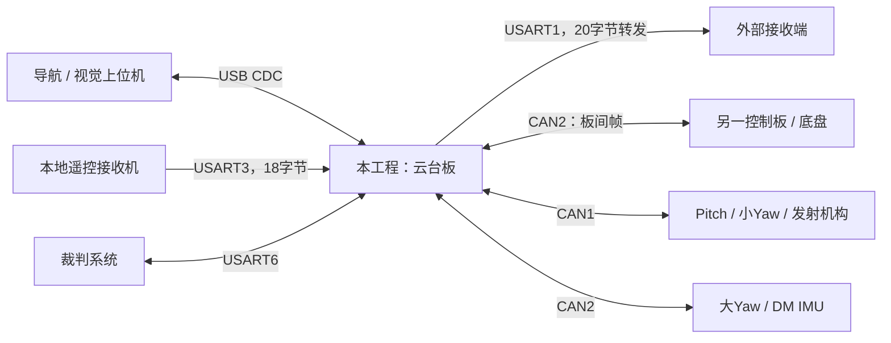

# 双板通信云台——当前通信协议说明

整理日期：2026-11-09  
适用工程：`D:\code-ai\新建文件夹 (2)\双板通信的云台`

本文以当前目录的源代码、实际收发调用和编译开关为依据，供云台、底盘、导航和视觉联调使用。周期是按源码时钟和调度推算的名义值，不代表抓包实测；未连接硬件验证，也不代表电路板内固件已经更新为这些源码。

本文记录现状。文中的兼容差异和缺项没有通过本次整理修改。

阅读入口：上位机联调重点看第3—5节；板间CAN看第6节；电机与DM IMU看第7—8节；串口遥控和裁判看第9—10节。第11节汇总实际调度，第12节列出当前接口差异，第13节提供离线CRC与组帧示例。

## 1. 接口总览

方向中的“本板”指当前云台控制板。

| 接口 | 通信对象 | 参数 | 当前用途 |
|---|---|---|---|
| USB FS CDC | 导航/视觉上位机 | 二进制字节流；虚拟串口波特率不决定实际吞吐 | 接收底盘/云台指令，反馈 IMU 和云台角度 |
| CAN1 | Pitch、小 Yaw、发射机构电机 | 1 Mbps，标准数据帧 | 电机命令与反馈 |
| CAN2 | 另一控制板、大 Yaw、DM IMU | 1 Mbps，标准数据帧 | 板间数据、电机命令/反馈、外置 IMU |
| USART3 | 本地遥控接收机 | 100000 baud；HAL 字长 8B、偶校验、1 停止位 | 接收 18 字节 DBUS 数据 |
| USART1 TX | 外部接收端 | 115200，8N1 | 转发本地收到的原始遥控数据，20 字节封装 |
| USART6 | 裁判系统 User 链路 | 115200，8N1 | 接收裁判信息，发送哨兵交互指令 |

STM32 引脚：CAN1 为 PD0/PD1（RX/TX），CAN2 为 PB5/PB6；USART3 为 PC11/PC10（RX/TX），USART1 为 PB7/PA9，USART6 为 PG9/PG14。它们是 MCU 引脚，板上连接器位置需看实际接线。

USART3 参数按 `Src/usart.c` 原样记录。STM32 的字长配置与校验位共同决定有效数据位，不能将 `UART_WORDLENGTH_8B + EVEN` 不经核对直接当作常规“8 个有效数据位 + 偶校验”。



### 1.1 当前启用的 USB 配置

`application/usb_task.h`：

| 宏 | 当前值 | 实际效果 |
|---|---:|---|
| `USB_YAW_DEBUG` | 0 | 启用视觉/导航收发，不发送调试波形 |
| `USB_ATS_COMPAT_FEEDBACK_TX` | 1 | 反馈只调度 ID `0x02` 与 `0x0C` |
| `USB_LEGACY_VISION_TX` | 1 | 仅当上一宏为 0 时生效，选择旧 42 字节反馈 |
| `USB_ATS_GCC_GIMBAL_MODE_FALLBACK` | 1 | 54 字节 ATS 导航帧的 Attack(1) 可触发云台接管 |

**当前 USB 正常反馈是 34 字节 IMU 帧和 22 字节角度帧。旧 42 字节视觉反馈、49 字节 `0x0E` 状态帧和 84 字节调试帧均未按当前配置调度。**

## 2. 数据编码约定

- 字节偏移从 0 开始；`0..3` 表示包含两端，共 4 字节。
- `u8/u16/u32` 为无符号整数；`i16` 为有符号 16 位二进制补码。
- USB 和裁判串口中的多字节数字、`float32` 为小端；`float32` 是 IEEE 754 单精度。
- 板间 CAN 的整数、电机整数为大端；板间 CAN 中直接 `memcpy` 的浮点数仍为小端。
- CAN 采用标准帧，不是 CAN FD；下文所列正常 CAN 报文均为 8 字节数据。
- 电机“命令值”和“反馈电流原始值”不直接等于安培，本文不代入未经核实的电机型号换算。
- USB 输入角度为 rad、角速度为 rad/s、角加速度为 rad/s²。旧 42 字节反馈单独使用度制。
- 输入时间戳会被保存，但当前接收逻辑主要使用本机 `HAL_GetTick()` 做超时，不按上位机时间戳做时钟同步、过期剔除或乱序拒绝。
- 上下位机坐标轴正方向、速度参考坐标系及枪管与 IMU 安装偏置，需要两端联合确认；本板报文转换不能证明这些关系已对齐。

## 3. USB 统一帧基础格式

### 3.1 帧结构

```text
SOF(1) + LEN(1) + ID(1) + CRC8(1) + timestamp(4) + data(N) + CRC16(2)
```

| 偏移 | 类型 | 字段 | 含义 |
|---|---|---|---|
| 0 | u8 | SOF | `0x5A` |
| 1 | u8 | LEN | 时间戳和 data 的总长度，即整帧长度 − 6 |
| 2 | u8 | ID | 按方向区分的消息 ID |
| 3 | u8 | CRC8 | 覆盖偏移 0..2 |
| 4..7 | u32 LE | timestamp | 发送端时间戳；本板反馈使用 ms |
| 8..末尾前2字节 | 字节序列 | data | 随消息定义 |
| 最后2字节 | u16 LE | CRC16 | 覆盖整帧除最后2字节之外的全部内容 |

校验算法：

| 校验 | 初值 | 右移实现的多项式 | 最终异或 |
|---|---|---|---|
| CRC8 | `0xFF` | `0x8C` | 无 |
| CRC16 | `0xFFFF` | `0x8408` | 无 |

CRC16 按低字节、高字节发送。当前 `usb_task.c` 的查表值与该逐位算法一致。

### 3.2 当前消息清单

| 方向 | ID/帧头 | 整帧字节数 | LEN | 用途 |
|---|---|---:|---:|---|
| 上位机 → 本板 | `0x5A / ID 0x01` | 54 | 48 | 当前 ATS GCC 导航/机器人命令兼容格式 |
| 上位机 → 本板 | `0x5A / ID 0x01` | 52 | 46 | 原 ARMCC 导航格式，兼容接收 |
| 上位机 → 本板 | `0x5A / ID 0x01` | 50 | 44 | 标准精简导航格式，兼容接收 |
| 上位机 → 本板 | `0x5A / ID 0x02` | 35 | 29 | 统一视觉云台指令 |
| 上位机 → 本板 | `0xA5` 旧帧头 | 28 | 无此字段 | 旧视觉云台指令，兼容接收 |
| 本板 → 上位机 | `0x5A / ID 0x02` | 34 | 28 | IMU 反馈，当前启用 |
| 本板 → 上位机 | `0x5A / ID 0x0C` | 22 | 16 | 角度反馈，当前启用 |
| 本板 → 上位机 | `0x5A / ID 0x0E` | 49 | 43 | 旧统一状态反馈，当前不调度 |
| 本板 → 上位机 | `0x5A` 旧帧头 | 42 | 无此字段 | 旧视觉状态反馈，当前不调度 |

**ID `0x02` 在两个方向的长度和含义不同。旧 42 字节帧虽然也以 `0x5A` 开头，但它没有统一帧头，不能按 `LEN+6` 解析。**

### 3.3 分包、粘包与发送行为

接收入口为 `CDC_Receive_FS() → unified_usb_receive_bytes()`，使用 512 字节环形缓冲（留一个位置区分空/满，容量 511），任务中拼帧：

- USB 回调收到的一个数据块不等于一帧；支持拆分帧和连续多帧。
- 统一帧先检查帧头 CRC8，再按 `LEN+6` 收齐并检查 CRC16。
- 拼帧缓冲 64 字节，统一帧允许 `4 ≤ LEN ≤ 58`；通过校验后仍需匹配支持的 ID 和长度。
- 校验失败逐字节寻找下一帧；环形缓冲溢出时置标记并重置正在拼接的帧。
- 当前反馈函数检查 USB 配置状态和 CDC 忙状态；忙时跳过，不阻塞控制任务、不保证补发。
- 正常收发任务约每 1 ms 运行；反馈调度每 5 ms 推进一个相位，四相位仅后两相位发 IMU、角度帧，各约 50 Hz。
- 接收成功不等于当前遥控模式允许云台或发射机构执行；控制状态机仍会仲裁。

## 4. 上位机 → 本板：控制帧

### 4.1 ATS 导航/机器人命令，54 字节

帧头 `5A 30 01 CRC8`。采用明确的线上偏移解析，避免 GCC 与 ARMCC 的 enum 大小不同。

| 偏移 | 字节数 | 类型 | 字段 / 单位 |
|---|---:|---|---|
| 0..3 | 4 | 帧头 | SOF、LEN=48、ID=1、CRC8 |
| 4..7 | 4 | u32 LE | timestamp |
| 8..11 | 4 | float32 | vx，m/s |
| 12..15 | 4 | float32 | vy，m/s |
| 16..19 | 4 | float32 | wz，rad/s |
| 20 | 1 | u8/bool | stop |
| 21..24 | 4 | GCC enum | mode；本板取偏移21，其余3字节应为0 |
| 25..28 | 4 | float32 | chassis.roll，rad |
| 29..32 | 4 | float32 | chassis.pitch，rad |
| 33..36 | 4 | float32 | chassis.yaw，rad |
| 37..40 | 4 | float32 | chassis.leg_length；本板仅保存，单位由上位机约定 |
| 41..44 | 4 | float32 | gimbal.pitch，rad |
| 45..48 | 4 | float32 | gimbal.yaw，rad |
| 49 | 1 | u8 | fire |
| 50 | 1 | u8 | fric_on |
| 51 | 1 | u8/bool | tracking |
| 52..53 | 2 | u16 LE | CRC16 |

姿态枚举来自当前 `usb_task.h`：

| mode | 名称 |
|---:|---|
| 1 | Attack |
| 2 | Defend |
| 3 | Move |
| 4 | EnhancedAttack |
| 5 | EnhancedDefend |
| 6 | EnhancedMove |

实际处理：

1. `stop != 0` 时，仅把转发的 `vx/vy` 清零，`wz` 仍取包内值。需要全停时必须同时发送 `wz=0`。
2. `tracking != 0` 或 `fire != 0` 时，本导航包接管云台目标。
3. 当前还启用“`mode==1` 视作接管”的 ATS 兼容逻辑，仅作用于这个 54 字节分支。
4. 接管时目标来自 `gimbal.yaw/pitch`；目标角速度置 0；`fire!=0` 转为视觉 mode=2，否则 mode=1。
5. 未接管时，若独立视觉指令在 100 ms 内有效，则恢复该视觉指令，否则视觉 mode 清零。
6. `chassis.roll/pitch/yaw/leg_length`、`fric_on` 等字段虽被解析或保存，不表示已经实现对应执行动作。
7. 不含 `custom_flag`；本板将本地对应字段置 0。当前代码未对所有输入浮点数统一做 NaN/Inf 和范围校验，上位机应发送有限且在约定范围内的值。

### 4.2 50 / 52 字节导航兼容格式

这两种格式的 enum mode 为 1 字节，与 54 字节帧不能直接互相 `memcpy`。

| 字段 | 50字节偏移 | 52字节偏移 |
|---|---|---|
| 帧头 / timestamp | 0..3 / 4..7 | 0..3 / 4..7 |
| vx / vy / wz | 8..11 / 12..15 / 16..19 | 相同 |
| stop / mode | 20 / 21 | 相同 |
| chassis.roll/pitch/yaw/leg_length | 22..25 / 26..29 / 30..33 / 34..37 | 相同 |
| gimbal.pitch / gimbal.yaw | 38..41 / 42..45 | 相同 |
| fire / fric_on | 46 / 47 | 相同 |
| tracking | 不包含 | 48 |
| custom_flag | 不包含 | 49 |
| CRC16 | 48..49 | 50..51 |
| LEN | 44 | 46 |

52 字节格式用 `tracking || fire` 决定云台接管，不启用 Attack 兜底。

50 字节格式没有 tracking，只有 `fire` 能通过该分支接管云台；`fire=0` 时该解析函数没有执行与 52/54 字节格式完全相同的即时视觉回退分支。不要假设它具备相同的接管退出时序。当前 ATS 联调优先使用匹配其发送端的 54 字节格式。

### 4.3 统一视觉指令，35 字节

帧头 `5A 1D 02 CRC8`。

| 偏移 | 字节数 | 类型 | 字段 / 单位 |
|---|---:|---|---|
| 0..3 | 4 | 帧头 | SOF、LEN=29、ID=2、CRC8 |
| 4..7 | 4 | u32 LE | timestamp |
| 8 | 1 | u8 | mode：0停止视觉控制、1瞄准、2瞄准并请求开火 |
| 9..12 | 4 | float32 | yaw，rad |
| 13..16 | 4 | float32 | yaw_vel，rad/s |
| 17..20 | 4 | float32 | yaw_acc，rad/s² |
| 21..24 | 4 | float32 | pitch，rad |
| 25..28 | 4 | float32 | pitch_vel，rad/s |
| 29..32 | 4 | float32 | pitch_acc，rad/s² |
| 33..34 | 2 | u16 LE | CRC16 |

只接受 mode=0/1/2。收到后更新独立视觉命令和接收时间；导航接管期间仍缓存该视觉命令，但不立即覆盖导航目标。角加速度字段会接收保存，不能据此认定当前控制器完整使用了角加速度前馈。

### 4.4 旧视觉指令，28 字节

没有统一帧头 CRC8、LEN、ID 和时间戳。

| 偏移 | 字节数 | 字段 |
|---|---:|---|
| 0 | 1 | head=`0xA5` |
| 1 | 1 | mode=0/1/2 |
| 2..5 | 4 | yaw |
| 6..9 | 4 | yaw_vel |
| 10..13 | 4 | yaw_acc |
| 14..17 | 4 | pitch |
| 18..21 | 4 | pitch_vel |
| 22..25 | 4 | pitch_acc |
| 26..27 | 2 | CRC16，小端 |

六个 float 与 35 字节视觉包含义、单位一致。CRC16 覆盖前 26 字节。`0xA5` 同时也是裁判串口帧头，但它们处于不同接口，结构完全不同。

### 4.5 超时

| 数据源 | 条件 | 当前软件处理 |
|---|---|---|
| 导航 USB | 距上次有效导航帧超过100 ms | vx/vy/wz清零；解除导航接管；若独立视觉仍新鲜则恢复，否则视觉mode清零 |
| 独立视觉 USB | 超过100 ms，且没有导航接管 | 视觉mode清零并更新处理状态 |
| 导航速度转发 | USB任务每约10 ms检查/发送 | 向CAN2发`0x113`，即使超时也会发送清零后的速度 |

这些是指令更新与门控行为，不是对物理停车时间或全车断动力的保证。上位机宜周期发送有效帧，不能只发一次；周期要明显小于100 ms，例如20 ms是可供联调使用的选择。

## 5. 本板 → 上位机：反馈帧

### 5.1 当前 IMU 反馈，ID=0x02，34 字节

帧头 `5A 1C 02 CRC8`。

| 偏移 | 字节数 | 类型 | 字段 / 数据源 |
|---|---:|---|---|
| 0..3 | 4 | 帧头 | LEN=28，ID=2 |
| 4..7 | 4 | u32 LE | 本板HAL时间戳，ms |
| 8..11 | 4 | float32 | yaw=INS_angle[0]，rad |
| 12..15 | 4 | float32 | pitch=INS_angle[1]，rad |
| 16..19 | 4 | float32 | roll=INS_angle[2]，rad |
| 20..23 | 4 | float32 | INS_gyro[2]，Z轴角速度，rad/s |
| 24..27 | 4 | float32 | INS_gyro[1]，Y轴角速度，rad/s |
| 28..31 | 4 | float32 | INS_gyro[0]，X轴角速度，rad/s |
| 32..33 | 2 | u16 LE | CRC16 |

角速度顺序是 **Z、Y、X**。这些是机体轴角速度，不应无条件等同于一般姿态下三个欧拉角的导数。

### 5.2 当前角度反馈，ID=0x0C，22 字节

帧头 `5A 10 0C CRC8`。

| 偏移 | 字节数 | 类型 | 字段 / 当前填充值 |
|---|---:|---|---|
| 0..3 | 4 | 帧头 | LEN=16，ID=12 |
| 4..7 | 4 | u32 LE | 本板时间戳，ms |
| 8..11 | 4 | float32 | 第一个yaw=INS_angle[0]，rad |
| 12..15 | 4 | float32 | 第二个yaw=INS_angle[0]，rad |
| 16..19 | 4 | float32 | pitch=INS_angle[1]，rad |
| 20..21 | 2 | u16 LE | CRC16 |

**两个 yaw 位置填的是同一个原始 INS yaw，不是大小 Yaw 各自的编码器关节角，也不是 `gimbal_control` 中可能经过航向参考修正后的 yaw。** 上位机不能把这两个数当作两个独立关节反馈。

当前这两类反馈不包含四元数、弹速、弹量、底盘实际速度或跟踪开关；不能套用历史 `0x0E` 的字段。

### 5.3 备用统一状态反馈，ID=0x0E，49 字节

当前不调度。只有将 `USB_ATS_COMPAT_FEEDBACK_TX=0` 且 `USB_LEGACY_VISION_TX=0` 才进入该发送分支。

| 偏移 | 字段 |
|---|---|
| 0..3 | 统一头：SOF=0x5A、LEN=43、ID=0x0E、CRC8 |
| 4..7 | timestamp，u32 LE，ms |
| 8 | 状态：导航接管为4；否则Follow_Vision为真时1，否则0 |
| 9..24 | INS_quat，四个float，顺序w/x/y/z |
| 25..28 | yaw=INS_angle[0]，rad |
| 29..32 | yaw_vel字段实际填INS_gyro[0]，rad/s |
| 33..36 | pitch=INS_angle[1]，rad |
| 37..40 | pitch_vel=INS_gyro[1]，rad/s |
| 41..44 | bullet_speed，float，来自CAN 0x116的字段 |
| 45..46 | bullet_count，u16，当前写0 |
| 47..48 | CRC16 |

旧状态帧的 yaw_vel 实际用了 X 轴数据，与当前34字节IMU包的Z轴位置不同，切换格式时必须核对，不能仅按字段名认定等价。

### 5.4 备用旧视觉反馈，42 字节

当前不调度。`USB_ATS_COMPAT_FEEDBACK_TX=0` 且 `USB_LEGACY_VISION_TX=1` 时使用。

| 偏移 | 字段 |
|---|---|
| 0 | header=0x5A |
| 1 | mode=Follow_Vision ? 1 : 0 |
| 2..17 | 四元数w/x/y/z，4个float |
| 18..21 | yaw，度 |
| 22..25 | yaw_vel字段=INS_gyro[0]转为度/s |
| 26..29 | pitch，度 |
| 30..33 | pitch_vel，度/s |
| 34..37 | bullet_speed，float，m/s语义 |
| 38..39 | bullet_count，u16，当前0 |
| 40..41 | CRC16 |

没有统一头CRC8。姿态来自原始INS；角度和角速度乘 `57.2957795`，与当前弧度反馈不能混用。

### 5.5 备用调试波形，84 字节

仅 `USB_YAW_DEBUG=1` 时启用：约100 Hz，`AA 55 + 20×float32 LE + 0D 0A`，没有上述CRC。该模式会忽略USB输入控制字节。

20通道顺序：时间、模式、Pitch相对目标、Pitch相对角、Pitch绝对角、Pitch目标速度、Pitch实际速度、Pitch命令、小Yaw相对目标、小Yaw相对角、小Yaw目标速度、小Yaw实际速度、小Yaw命令、大Yaw相对目标、大Yaw相对角、大Yaw目标速度、大Yaw实际速度、大Yaw命令、DM在线、DM数据年龄。

相对目标在INIT中才是对应初始化控制目标；其他模式下可能保留旧值。详见同目录《当前三轴监测使用说明.md》。

## 6. 板间 CAN2 协议

### 6.1 ID 总表

| ID | 本工程行为 | 内容 |
|---|---|---|
| `0x111` | 接收，也主动发送 | 遥控基础通道、拨杆 |
| `0x112` | 接收，也主动发送 | 遥控拨轮、键盘 |
| `0x113` | 发送 | 底盘导航vx/vy/wz |
| `0x114` | 接收 | 颜色/状态、热量、热量上限 |
| `0x115` | 发送 | 视觉状态Vision_state |
| `0x116` | 接收 | 一个float弹速字段 |
| `0x117` | 仅定义枚举 | 当前没有对应收发分支 |
| `0x118` | 接收 | HP、比赛阶段、冷却值 |
| `0x119` | 接收 | 比赛剩余时间 |
| `0x120` | 接收，也主动发送 | 鼠标 |
| `0x121` | 发送 | 大Yaw编码器零位与当前编码器 |
| `0x301` | 接收 | yaw_acc.groy，一个float |
| `0x030/0x031` | 请求/响应 | DM IMU，见第8节 |
| `0x1FF/0x205` | 电机命令/反馈 | 大Yaw，见第7节 |

板间命名主要来自当前源码。另一块板子是否仍按完全一致的格式实现，需要在对应工程核对；本文未修改另一块板子。

### 6.2 遥控基础帧，0x111

| 字节 | 类型 | 内容 |
|---|---|---|
| 0..1 | i16 BE | ch[0] |
| 2..3 | i16 BE | ch[1] |
| 4..5 | i16 BE | ch[2] |
| 6 | u8 | s[1]，本工程RC_Left |
| 7 | u8 | s[0]，本工程RC_Right |

拨杆值：上=1，中=3，下=2。通道为已减去1024的数值，常用范围约−660..+660。

**当前这帧没有ch[3]。0x112也没有补充ch[3]。** 本地USART3会更新ch[3]，但若只使用当前CAN遥控转发，它不会跟随第四个摇杆通道变化。云台校准手势与Pitch手动输入都可能依赖ch[3]；这是协议缺项的条件性影响，不是已实测故障。

### 6.3 遥控辅助帧，0x112

| 字节 | 类型 | 内容 |
|---|---|---|
| 0..1 | i16 BE | ch[4]，拨轮 |
| 2..3 | u16 BE | 键盘位图key.v |
| 4..7 | 字节 | 本工程发送时置0，接收忽略 |

键盘bit0..15依次：W、S、A、D、SHIFT、CTRL、Q、E、R、F、G、Z、X、C、V、B。

### 6.4 鼠标帧，0x120

| 字节 | 类型 | 内容 |
|---|---|---|
| 0..1 | i16 BE | mouse.x |
| 2..3 | i16 BE | mouse.y |
| 4..5 | i16 BE | mouse.z |
| 6 | u8 | mouse.press_l |
| 7 | u8 | mouse.press_r |

三类CAN遥控帧和本地有效DBUS帧共用 `rc_ctrl` 与 `rc_last_can_tick`。没有按来源互斥，也没有为每个通道组分别维护时效。任意一种帧刷新时间都会影响整体遥控在线判断，不能把“整体在线”等同于“所有通道都新鲜”。

超过100 ms未刷新或时间戳为0时，清零遥控结构，双拨杆置下。`RC_data_is_error()` 当前按这个超时判断返回，原先更细的通道范围检查块已被注释。

### 6.5 底盘导航速度帧，0x113

| 字节 | 类型 | 内容 / 解码近似 |
|---|---|---|
| 0..1 | i16 BE | vx_raw；vx≈raw/16000，m/s |
| 2..3 | i16 BE | vy_raw；vy≈raw/16000，m/s |
| 4..5 | i16 BE | wz_raw；wz≈raw×6/32000，rad/s |
| 6..7 | 字节 | 固定0 |

发送端使用 `float_to_int16()`：

```text
raw = trunc((value - min)/(max - min) × 64000 - 32000 + 0.5)
vx/vy: min=-2, max=2
wz:    min=-6, max=6
```

trunc为C转换到整数时向0截断。因统一加0.5，负数存在1计数舍入偏差，不应把它写成两侧完全对称的四舍五入。当前函数没有输入范围饱和处理，上位机应限制vx/vy于±2 m/s、wz于±6 rad/s，避免超范围转换。

示例：vx=1、vy=0、wz=0时，数据为：

```text
3E 80 00 00 00 00 00 00
```

接收方应按底盘约定坐标系解释vx/vy；本函数仅缩放，不进行坐标旋转。`stop`、姿态mode、云台角度没有放进此CAN帧。

### 6.6 裁判相关板间数据

这些是队内压缩CAN帧，不是官方裁判UART帧。

| ID | 字节 | 字段 / 类型 |
|---|---|---|
| 0x114 | 0 | Refree_data.Vision_ID，u8；取值由发送方约定 |
| 0x114 | 1..2 | shooter_17mm_barrel_heat，u16 BE |
| 0x114 | 3 | gimbal_state，u8 |
| 0x114 | 4..5 | shooter_barrel_heat_limit，u16 BE |
| 0x114 | 6..7 | 当前接收逻辑忽略 |
| 0x116 | 0..3 | Refree1_data.launching_frequency，float32 LE；代码把它作弹速使用 |
| 0x116 | 4..7 | 忽略 |
| 0x118 | 0..1 | current_Hp，u16 BE |
| 0x118 | 2 | game_progress；本地成员为4位位域，只保留低4位 |
| 0x118 | 3..4 | shooter_barrel_cooling_value，u16 BE |
| 0x118 | 5..7 | 忽略 |
| 0x119 | 0..1 | stage_remain_time，u16 BE，s语义 |
| 0x119 | 2..7 | 忽略 |
| 0x301 | 0..3 | yaw_acc.groy，float32 LE；本接收函数未给出物理单位 |
| 0x301 | 4..7 | 忽略 |

`0x116` 的成员名 `launching_frequency` 容易误导：这里按后续使用是弹速float；官方 `shoot_data.launching_frequency` 是射频u8/Hz，官方弹速则是 `initial_speed`。两种结构不能直接互拷。

当前CAN接收分支没有为这些裁判相关值设置独立超时清零。USART6官方结构和上述CAN结构也不是同一份内存，不能假设串口更新后会自动同步所有CAN消费变量。

### 6.7 视觉状态，0x115

| 字节 | 内容 |
|---|---|
| 0 | Vision_state：当前视觉任务中来自st.mode，0/1/2语义见视觉指令 |
| 1..7 | 未定义，不应读取其业务含义 |

发送函数只写第0字节，复用与0x121共用的 `board_send_data` 缓冲，没有逐帧清空尾部；尾部可能是上一次其他报文留下的内容，**不能认为恒为0**。

### 6.8 大Yaw编码器反馈，0x121

| 字节 | 类型 | 内容 |
|---|---|---|
| 0..1 | u16 BE | 大Yaw offset_ecd，当前有效参数路径设为7773 |
| 2..3 | u16 BE | 大Yaw当前原始ecd |
| 4 | u8 | 固定1 |
| 5..7 | 字节 | 固定0 |

第4字节当前硬写1，没有依据电机反馈年龄更新，不能当作严格的电机在线标志。该帧不包含Pitch、小Yaw或IMU世界航向。

## 7. 电机 CAN 协议

### 7.1 云台命令与反馈对应

| 轴 | 总线 | 命令ID | 有效命令字节 | 反馈ID |
|---|---|---|---|---|
| Pitch | CAN1 | 0x1FF | 2..3，i16 BE | 0x206 |
| 大Yaw | CAN2 | 0x1FF | 0..1，i16 BE | 0x205 |
| 小Yaw | CAN1 | 0x2FF | 4..5，i16 BE | 0x20B |

每次发送使用独立8字节帧，仅填本轴命令位置，其余字节清零。相同数值ID在不同CAN总线上的对象不同。

控制变量与发送符号：当前 `PITCH_TURN=1`，Pitch待发命令为 `-given_current`；`YAW_TURN=0`、`YAW2_TURN=0`，Yaw命令不在此处取反。物理抬头/转向还需以实际安装验证。

### 7.2 电机反馈载荷

| 字节 | 类型 | 内容 |
|---|---|---|
| 0..1 | u16 BE | 原始编码器ecd，单圈0..8191 |
| 2..3 | i16 BE | speed_rpm |
| 4..5 | i16 BE | given_current，原始反馈值 |
| 6 | u8 | temperate，温度字段 |
| 7 | u8 | 当前解析忽略 |

该解析也用于发射机构反馈。云台反馈接收要求标准数据帧且DLC=8，并记录接收时间。机械校准要求相关反馈年龄不超过50 ms；不能因此推断普通控制所有路径都执行了同样的电机反馈超时检查。

### 7.3 发射机构

| 类型 | 总线 | ID | 布局 |
|---|---|---|---|
| 命令 | CAN1 | 0x200 | 4个i16 BE，分别位于0..1、2..3、4..5、6..7 |
| 反馈 | CAN1 | 0x201 | ShootMotor[0]，拨弹反馈 |
| 反馈 | CAN1 | 0x203 | ShootMotor[1]，左摩擦轮反馈 |
| 反馈 | CAN1 | 0x204 | ShootMotor[2]，右摩擦轮反馈 |

函数形参名为 `CAN_CmdShoot(right,left,Trigger,A)`，但当前任务实际传参：

```c
CAN_CmdShoot(give_current[2], 0, give_current[1], give_current[0]);
```

即4个命令槽依次为 `give_current[2]、0、give_current[1]、give_current[0]`。命令槽不能只凭形参名与反馈ID推断接线，需结合实际电机ID确认。`SHOOT_CAN` 宏虽然写hcan2，实际这个发送函数和反馈分支用的是CAN1。

### 7.4 其他电机接口

`CAN_receive.c` 还保留MIT、位置速度和使能命令函数；在当前application/Src调用搜索中只有定义，未发现正常任务调用。它们不属于本工程当前周期通信主链路，不作为已启用电机协议使用。

## 8. DM 外置 IMU，CAN2

### 8.1 请求帧

- 本板 → DM IMU：标准ID `0x030`，DLC=8。
- DM IMU → 本板：标准ID `0x031`，DLC=8。
- `main.c` 仅设置本地ID和CAN句柄，不会在启动时自动保证外置设备参数已经一致。

| 字节 | 内容 |
|---|---|
| 0 | 0xCC |
| 1 | 寄存器ID |
| 2 | 读写：0=读，1=写 |
| 3 | 0xDD |
| 4..7 | 写入值u32 LE；读取时为0 |

周期读取角速度：

```text
CAN2 ID=0x030 DLC=8
CC 02 00 DD 00 00 00 00
```

### 8.2 角速度响应

按当前解析器：第0字节为数据类型 `0x02`，第1字节当前不使用，后三个u16是小端量化值。

| 字节 | 内容 |
|---|---|
| 0 | 0x02，角速度类型 |
| 1 | 当前解析忽略 |
| 2..3 | X轴原始量u16 LE |
| 4..5 | Y轴原始量u16 LE |
| 6..7 | Z轴原始量u16 LE |

```text
gyro = raw / 65535 × (34.88 - (-34.88)) - 34.88
```

本工程以rad/s使用。它是无符号线性量化，不是有符号i16直接除比例，也不是float32。

收到角速度后更新 `imu.last_gyro_rx_tick` 和 `gyro_valid`；快照有效条件包含收到过数据、年龄≤20 ms、Z轴值处于±34.88范围。大Yaw使用DM的Z轴速度反馈，经过当前方向系数；USB IMU反馈则来自板载INS，二者不能混为同一数据源。

### 8.3 其余保留接口

| 寄存器 | 用途 |
|---|---|
| 0x01 / 0x02 / 0x03 / 0x04 | 加速度 / 角速度 / 欧拉角 / 四元数 |
| 0x05 / 0x06 / 0x07 | 置零 / 加速度校准 / 陀螺仪校准 |
| 0x09 / 0x0A / 0x0B | 通信口 / 主动间隔 / 主动或请求模式 |
| 0x0C / 0x0D / 0x0E | 波特率 / CAN_ID / MST_ID |
| 0xFE / 0xFF | 保存参数 / 恢复设置 |

当前定时器周期请求的是0x02角速度。其他响应虽有解析函数，不代表已周期发送或完成设备侧验证。

## 9. 串口遥控协议

### 9.1 USART3 本地 DBUS，18 字节

当前空闲中断仅在本次DMA接收长度恰好18时解码；不能据此声称支持任意拆包、粘包或一次36字节双帧。36字节是单个DMA缓冲长度，不是单帧长度。

设接收字节为 `b[0]..b[17]`，4个摇杆通道：

```text
ch0 = ((b0 | b1<<8) & 0x7FF) - 1024
ch1 = ((b1>>3 | b2<<5) & 0x7FF) - 1024
ch2 = ((b2>>6 | b3<<2 | b4<<10) & 0x7FF) - 1024
ch3 = ((b4>>1 | b5<<7) & 0x7FF) - 1024
s0  = (b5>>4) & 0x03
s1  = (b5>>6) & 0x03
```

| 字节 | 内容 |
|---|---|
| 0..5 | 摇杆4通道与拨杆，按位打包 |
| 6..7 / 8..9 / 10..11 | mouse.x/y/z，i16 LE |
| 12 / 13 | 鼠标左/右键 |
| 14..15 | 键盘u16 LE |
| 16..17 | ch4原始值u16 LE，减1024 |

拨杆在本工程业务映射为 `s[0]=RC_Right`、`s[1]=RC_Left`，以头文件宏与业务代码为准，不沿用解码处的旧英文左右注释。

### 9.2 USART1 遥控转发，20 字节

每次本地USART3成功解析18字节后调用：

```text
A6 + 原始DBUS18字节 + sum8
```

| 偏移 | 内容 |
|---|---|
| 0 | 固定0xA6 |
| 1..18 | 原始DBUS字节，不是RC_ctrl_t结构体 |
| 19 | 偏移0..18之和的低8位 |

发送由USART1 TX DMA完成。这个sum8不是CRC8。当前工程只证明发送路径存在，外部接收端是否使用该封装需另查对端。

## 10. 裁判系统 USART6 协议

### 10.1 版本与帧结构

当前源码标识：`2027-V1.0.0-20261029`。本节归纳本工程已实现部分，完整字段语义以对应版本原始协议及 `application/referee.h` 为准；不能把旧赛季长度套进当前结构。

```text
A5 + data_length(u16 LE) + seq(u8) + CRC8(u8)
   + cmd_id(u16 LE) + data(data_length字节) + CRC16(u16 LE)
```

| 偏移 | 字节数 | 字段 |
|---|---:|---|
| 0 | 1 | SOF=0xA5 |
| 1..2 | 2 | data_length，仅数据段长度 |
| 3 | 1 | seq |
| 4 | 1 | CRC8，覆盖0..3 |
| 5..6 | 2 | cmd_id |
| 7..(7+data_length−1) | data_length | 数据段 |
| 最后2字节 | 2 | CRC16 |

总长=`data_length+9`。CRC8/16与第3节列出的逐位算法一致，但覆盖范围不同。上层命令ID与USB/CAN各自独立，数字相同不代表同一业务。

接收双缓冲各512字节、FIFO 2048字节；任务约每10 ms排空FIFO。解析支持最大300字节数据段/309字节整帧，验证帧头、CRC、实际整帧长度和支持命令的数据长度；未知命令不更新对应状态。

### 10.2 已实现接收命令索引

长度为数据段长度，不含头、cmd_id及CRC16。

| cmd_id | 字节数 | 本地对象 / 用途 |
|---|---:|---|
| 0x0001 | 11 | game_state，比赛状态 |
| 0x0002 | 1 | game_result |
| 0x0003 | 24 | game_robot_HP |
| 0x0101 | 8 | field_event |
| 0x0104 | 3 | referee_warning |
| 0x0105 | 3 | dart_info |
| 0x0201 | 17 | robot_state |
| 0x0202 | 14 | power_heat_data |
| 0x0203 | 12 | game_robot_pos；angle使用度 |
| 0x0204 | 7 | buff |
| 0x0206 | 7 | robot_hurt |
| 0x0207 | 7 | shoot_data；射频Hz、弹速m/s分别存储 |
| 0x0208 | 8 | projectile_allowance |
| 0x0209 | 6 | robot_rfid |
| 0x020A | 6 | dart_client_cmd |
| 0x020B | 40 | ground_robot_position |
| 0x020C | 2 | radar_mark_data |
| 0x020D | 14 | SentryInfo |
| 0x020E | 8 | RadarInfo |
| 0x0301 | 6+用户内容长度，最大118 | robot_interaction_data及子命令分发 |
| 0x0303 | 12 | map_command |
| 0x0305 | 48 | map_robot_data |
| 0x0307 | 105 | map_data |
| 0x0308 | 34 | custom_info |
| 0x0310 | 300 | robot_custom_data_2 |
| 0x0311 | 60 | robot_custom_data |

0x0310/0x0311具备类型和解析容量，不代表当前115200 User口已接入需要另一图传链路的业务。有效包计数与最后接收时间仅记录支持且校验通过的命令。

0x0301用户内容长度：删除层0x0100为2；图形0x0101/0102/0103/0104分别15/30/75/105；字符0x0110为45；哨兵0x0120为4；雷达0x0121为13。队内自定义子命令0x0200..0x02FF接受不超过112字节的内容。

### 10.3 当前哨兵发送指令

约10 Hz发送，只有本机 `robot_state.robot_id` 为7或107才发送：

| 字段 | 值 |
|---|---|
| cmd_id | 0x0301 |
| data_length | 10 |
| 子命令data_cmd_id | 0x0120 |
| sender_id | 本机7或107 |
| receiver_id | 0x8080 |
| 用户数据 | sentry_cmd，u32 LE |
| 整帧长度 | 19字节 |

`sentry_cmd` 当前生成方式：

- bit0：收到的状态允许免费复活时置1。
- bit21..23：来自最近保存的导航 `speed_vector.mode`，允许1..6，否则回退3。
- bit24：`sentry_activate_rune` 非零时置1，默认0。
- 本函数其余位保持0。

导航超时处理会清速度，但未清掉保存的mode；不能假设导航断链后姿态请求也会同步清零。

## 11. 发送周期与总线实际行为

根据当前HSE=12 MHz、PLL配置推算：系统168 MHz，APB1=42 MHz；CAN分频3，1+10+3=14TQ，因此CAN1/2均为1 Mbps。APB1定时器时钟84 MHz。

| 触发源 | 源码配置 | 名义行为 |
|---|---|---|
| TIM2 | PSC=167，ARR=999 | 中断每2 ms，约500 Hz |
| TIM2奇数轮 | 每两轮一次 | DM角速度请求约250 Hz |
| TIM2偶数轮 | 每两轮一次 | Pitch与大Yaw命令各约250 Hz |
| 云台任务 | 延时1 tick | 小Yaw每轮调用CAN发送，周期受任务调度影响 |
| TIM2轮转槽0/2/4/8 | 20个中断一轮 | 0x111/112/120/113各约25 Hz，轮转总周期40 ms |
| USB任务 | 每约10 ms | 另发0x113，约100 Hz |
| TIM6 | PSC=1049，ARR=3999 | 每50 ms发送0x121和0x115，约20 Hz |
| USB反馈 | 每5 ms推进四相位 | 当前0x02、0x0C各约50 Hz |
| ShootTask | 延时1 tick | 每轮发CAN1 0x200 |
| 裁判任务 | 每100 ms判断发送 | 合法哨兵ID下约10 Hz发0x0301/0x0120 |

源码中“20 ms slot”的注释与当前TIM2实际参数不一致：20个2 ms槽是40 ms。本文按实际时钟推算值记录。

**两处实际调用需要联调时注意：**

1. TIM2仍发送0x111/112/120，不能仅依据TIM6注释写成“本板完全不广播遥控”。本板也接收这三个ID，多板同时广播相同ID时需确认消息属主和回灌行为。
2. 0x113既由USB任务发送，也由TIM2轮转发送，不是单一固定100 Hz来源，重复帧和间隔应以抓包为准。

当前CAN1/2关闭自动重发、自动Bus-Off恢复。部分发送函数没有空邮箱检查或重试；其他函数可能空邮箱不足就跳过。上述频率是尝试调度频率，不能当作成功上总线的保证。板间发送还复用部分header/buffer，应在多中断/任务并行场景下用抓包验证完整性；本次文档整理未重构该行为。

## 12. 联调时优先核对的差异

| 现象 / 关注点 | 当前代码依据 |
|---|---|
| 上位机等不到0x0E或旧42字节状态 | 当前只调度34字节0x02与22字节0x0C |
| ROS导航文档与本板当前反馈不同 | 参考文档存在0x0E说明，需按本板当前启用格式和实际对端代码联合确认 |
| 机器人包字段错位 | 54字节GCC enum占4字节；50/52字节ARMCC enum占1字节 |
| stop=1仍可能有旋转指令 | 仅vx/vy被stop清零，wz保持输入 |
| 54字节Attack模式主动接管云台 | 当前启用Attack(1)兜底，不要求tracking一定为1 |
| CAN遥控下Pitch不随杆、校准手势不能满足 | 当前0x111/112缺ch3；仅CAN输入且无其他来源更新时受影响 |
| 遥控看似在线但部分通道不更新 | 本地DBUS与三类CAN遥控共用一个时间戳 |
| 0x115尾部有非零值 | 尾部未逐帧清零，不是新定义字段 |
| 上位机看到两个相同yaw | 0x0C两位置都写INS_angle[0]，并非双编码器角 |
| 弹速、射频混淆 | CAN0x116为float弹速使用；官方0x0207射频是u8、弹速是另一float |
| 软件目标限位不能证明不会顶机械限位 | 协议只传输数据，Pitch实际闭环方向/零位/范围需另行检查 |
| 有定义但抓不到0x117或其他电机协议 | 枚举/函数存在不等于当前任务启用 |

建议先用下列数据定位链路，再检查控制效果：

- USB：明确方向、ID、整帧长度、LEN与CRC；不要按一次串口read的长度切帧。
- CAN：同时记录总线编号、ID、DLC、8字节数据和间隔。
- 遥控：记录ch[0..4]、s[0..1]及接收时间，确认实际来源。
- 导航：确认USB速度输入与CAN0x113缩放一致，超时后速度归零。
- IMU：区分板载INS和DM外置IMU；核对角度单位及角速度轴序。
- 姿态控制与射击：接收和执行分别核对，不把收到fire或fric_on等同实际发射动作。

## 13. CRC参考与可复核示例

以下Python只用于本地组帧、离线校验，没有打开串口或发送动作。USB和裁判均可复用CRC算法，但各自帧头覆盖范围须按前文定义。

```python
import struct

def crc8(data):
    crc = 0xFF
    for value in data:
        crc ^= value
        for _ in range(8):
            crc = (crc >> 1) ^ 0x8C if crc & 1 else crc >> 1
    return crc

def crc16(data):
    crc = 0xFFFF
    for value in data:
        crc ^= value
        for _ in range(8):
            crc = (crc >> 1) ^ 0x8408 if crc & 1 else crc >> 1
    return crc

def unified_frame(msg_id, timestamp, data):
    payload = struct.pack('<I', timestamp) + data
    header = bytes([0x5A, len(payload), msg_id])
    packet = header + bytes([crc8(header)]) + payload
    return packet + struct.pack('<H', crc16(packet))

# 35字节视觉停止包，timestamp=0，六个float全0
vision_stop = unified_frame(0x02, 0, struct.pack('<B6f', 0, *([0.0] * 6)))
assert len(vision_stop) == 35

# 54字节ATS导航包：速度0，stop=1，Move=3，不请求跟踪/开火
# mode显式用4字节无符号整数，避免编译器enum大小差异
nav_data = struct.pack('<3fBI6f3B',
                       0.0, 0.0, 0.0, 1, 3,
                       *([0.0] * 6), 0, 0, 0)
navigation_stop = unified_frame(0x01, 0, nav_data)
assert len(navigation_stop) == 54

assert crc8(b'123456789') == 0x0B
assert crc16(b'123456789') == 0x6F91
```

上述35字节示例应为：

```text
5A 1D 02 1A 00 00 00 00 00 00 00 00 00 00 00 00
00 00 00 00 00 00 00 00 00 00 00 00 00 00 00 00 00 1E CC
```

上述54字节示例应为：

```text
5A 30 01 B0 00 00 00 00 00 00 00 00 00 00 00 00
00 00 00 00 01 03 00 00 00 00 00 00 00 00 00 00
00 00 00 00 00 00 00 00 00 00 00 00 00 00 00 00
00 00 00 00 4C FA
```

两份示例CRC16已用当前C源码的256项查表与独立逐位算法交叉核对；它们是离线构造样例，不是实机抓包。mode=0或stop=1的语义也仅按当前协议解释，不代替急停。

## 14. 源码查阅入口

下表路径相对于本文开头列出的工程根目录。

| 文件 | 查阅内容 |
|---|---|
| application/usb_task.h | 当前USB宏、导航/视觉结构体、尺寸定义 |
| application/usb_task.c | USB流拼帧、三类导航解析、视觉仲裁、超时和反馈打包 |
| Src/usbd_cdc_if.c | CDC收发入口 |
| application/CAN_receive.h | CAN ID枚举、板间结构体 |
| application/CAN_receive.c | CAN路由、大小端、各帧字节布局 |
| Src/bsp_pid.c | TIM2/TIM6发送调度 |
| Src/tim.c、Src/main.c、Inc/stm32f4xx_hal_conf.h | 定时器和时钟，用于推算周期 |
| Src/can.c | CAN位时序、引脚及自动重发配置 |
| application/remote_control.c/.h | DBUS、USART1转发、CAN遥控更新和超时 |
| Src/usart.c | 串口参数和引脚 |
| components/devices/dm_imu.c/.h | DM请求、量化解码和20ms有效性判断 |
| application/protocol/protocol.h | 当前裁判版本、帧头、cmd_id |
| application/referee.c/.h | 裁判类型、长度验证、分发 |
| application/referee_usart_task.c/.h | 裁判DMA/FIFO、哨兵0x0120发送 |
| components/support/CRC8_CRC16.c | 裁判CRC实现 |
| Src/Vision_Task.c | 视觉mode和目标的后续使用 |
| Src/shoot_task.c | 发射机构命令实际参数顺序 |
| 验证/视觉接口协议对齐/导航与视觉和电控通信接口文档.md | 对端ROS参考资料；与当前本板反馈不同的部分需联合核对 |
| 排查记录/20261031-裁判协议2027/修改与验证说明.md | 裁判协议迁移历史，不能替代当前源码 |

